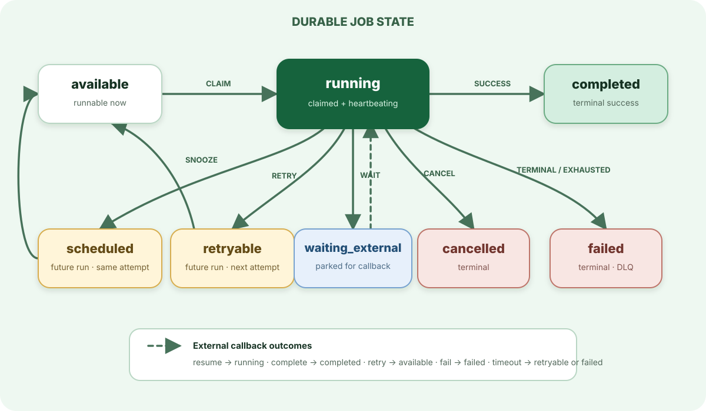

> For the complete AWA documentation index, see [`llms.txt`](../../llms.txt).

# Job lifecycle

A job moves through durable states in PostgreSQL. The handler returns the next outcome; AWA validates that the current worker still owns the claim before applying it.

## Common paths

`available → running → completed`
: The normal path. Claiming increments the attempt before the handler runs.

`running → retryable → available`
: A retry records the error and a future run time. Once due, the job is runnable again if attempts remain.

`running → scheduled → available`
: A snooze defers the same attempt. It is useful for polling an external system without consuming the retry budget.

`running → waiting_external → running`
: The handler parks while an external operation runs. A resuming callback stores the result and returns the job to `running`, where the still-live handler observes it.

`waiting_external → completed | failed`
: A callback may finalize the job directly. Callback policy failure also moves the job to `failed`.

`waiting_external → available`
: An explicit callback retry starts the job again from scratch and resets its attempt count. This is distinct from resuming the parked handler.

`waiting_external → retryable | failed`
: When a callback deadline expires, maintenance retries the job if attempts remain and otherwise fails it.

`running → failed | cancelled`
: Terminal outcomes. Failed jobs can be retained in the dead-letter queue according to policy.

## What crash recovery means

A running job is owned only for as long as its claim remains live. Heartbeats extend that claim. If the process stops, another worker can rescue the job after the claim expires. The original worker may still finish late, so completion writes are guarded by ownership and handlers must tolerate duplicate execution.

## Poison jobs

A poison job fails the same way on every attempt: bad input that crashes a parser, a payload that exhausts memory, a call that never returns. Every way an attempt can end counts against the job's `max_attempts`, so a poison job stops instead of cycling forever:

| The attempt ends because | Error recorded on the job | Once attempts are spent |
| --- | --- | --- |
| the handler returns an error or raises an exception | the error | `failed`, or DLQ reason `max_attempts_exhausted` |
| the handler panics (Rust) | `handler panicked: <message>` | `failed`, or DLQ reason `max_attempts_exhausted` |
| the worker stops heartbeating: crash, OOM kill, eviction, a native extension segfault | `heartbeat stale: worker presumed dead` (`receipt claim stale: …` on the receipt path) | `failed`, or DLQ reason `heartbeat_stale` |
| the attempt outlives the queue's `deadline_duration` | `hard deadline exceeded` | `failed`, or DLQ reason `deadline_exceeded` |
| a callback wait times out | `callback timed out` | `failed`, or DLQ reason `callback_timeout` |
| a terminal error, arguments that do not deserialize, or a kind no worker handles | the error | `failed` at once, or DLQ reason `terminal_error` |

`failed` jobs move to the [dead-letter queue](../../dead-letter-queue/index.md) when the queue has it enabled. `Snooze` never spends an attempt.

A crash ends every attempt running in that process, not just the poison one, so jobs that only shared the worker spend an attempt too. Keep `max_attempts` above one for work that should survive losing a node: with one attempt, any crash fails the job.

### Designing for it

- Raise a terminal error (`JobError::terminal`, `awa.TerminalError`) for input that can never succeed, so it skips the retries.
- Enable the DLQ on queues whose failures someone should inspect and redrive.
- Set `deadline_duration` close to the slowest legitimate attempt. It bounds how long a hung handler holds a worker before its attempt is counted; shortly after the deadline the worker drops a handler that is still waiting, so a hang cannot hold its slot forever. Code that blocks without yielding cannot be dropped, so give blocking calls their own timeouts.
- Put kinds that call fragile native code or unbounded external work on their own queue and worker pool, so a crash only takes down work that shares the risk.

### When one turns up in production

1. **Recognise it.** The job's error history repeats one message across attempts. `awa job dump <id>` shows each attempt; a run of `presumed dead` or `hard deadline exceeded` errors points at the process, not the handler's own error path.
2. **Stop one job.** `awa job cancel <id>`. A running handler is signalled to stop. One stuck in blocking or CPU-bound code keeps its worker slot until it returns, but the job stays cancelled: a late finish is ignored.
3. **Stop a kind.** `awa queue pause <queue>` holds everything on the queue while you deploy a fix. Until a fix ships, the bound above ends each poison job after `max_attempts`.
4. **Redrive after the fix.** `awa dlq retry-bulk --queue <queue> --kind <kind>` re-runs the dead-lettered jobs with a fresh attempt budget.

## Where to go next

- Configure attempts, delays, timeouts, and queue concurrency in [Configuration](../../configuration/index.md).
- Design idempotent effects with [Transactional enqueue](../transactional-enqueue/index.md).
- Inspect and redrive terminal failures with the [Dead-letter queue](../../dead-letter-queue/index.md).
- Use [Callbacks](../../http-callbacks/index.md) for externally completed work.
