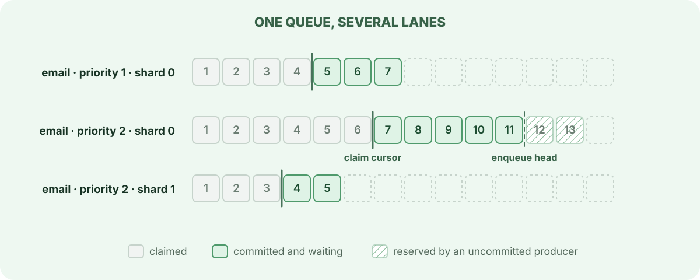

> For the complete AWA documentation index, see [`llms.txt`](../../llms.txt).

# Lanes and claiming

Every runnable job sits in a **lane**: an ordered sequence for one `(queue, priority, enqueue_shard)`. A lane has two cursors. Producers append at the enqueue head; workers take jobs from the claim cursor. Everything between them is committed and waits for a worker, except jobs cancelled before they were claimed and, for a moment after a claim commits, the jobs it just took: the claim moves the cursor past them in a separate step.

## Enqueue: a lane is visible in commit order

A producer reserves the next sequence numbers on the lane, writes its ready rows and records the reserved range. It holds a transaction-scoped lock on the lane until it commits or rolls back. A second producer on the same lane waits for that lock, so position `N + 1` can never become visible while position `N` might still commit. In the diagram, positions 12 and 13 belong to a producer that has not committed; workers cannot see them yet, and nothing behind them can jump the queue.

A job with a future `run_at`, or one that is snoozed or waiting for a retry, is written to deferred jobs instead. The maintenance leader moves it into its lane when it is due.

The lane lock lasts until commit, so keep enqueue transactions short when many producers share a lane. A long transaction that enqueues and then does other work stalls every producer behind it on that lane.

## Claim: take the head, advance the cursor

A worker asks for up to a batch of jobs from the queues it serves. For each lane the claim:

1. locks the lane's claim cursor with `SKIP LOCKED`, so a worker never waits behind another worker on the same lane, it moves on;
2. reads the next committed jobs after the cursor;
3. writes [claim receipts](../claims-receipts-and-leases/index.md) for them, or leases when `lease_claim_receipts` is off, and advances the cursor past them.

Claiming reads ready rows by position and never rewrites them. A ready row is written once and stays unchanged until its slot is [truncated](../rings/index.md); the cursor alone records how far the lane has been consumed.

## Priority and ordering

Priority runs from 1 (first) to 4. A worker prefers the lane whose head has the best **effective** priority, which improves the longer the head job has waited, so low-priority work cannot starve unless the queue turns aging off. See [Job priority and aging](../../configuration/index.md#job-priority-and-aging). Within one lane, jobs come out in sequence order.

Ordering is only promised within a lane:

- Two jobs on the same queue and priority, enqueued ready to run by separate transactions, come out in commit order when the queue has one shard.
- A scheduled, snoozed or retrying job joins its lane when it is promoted, behind whatever was enqueued before then.
- With several enqueue shards, each shard is its own lane. Order holds within a shard, not across shards.
- Jobs at different priorities are ordered by effective priority, not by when they were enqueued.

## Shards: more lanes for one hot queue

One lane admits one claimer and one producer at a time. When a single `(queue, priority)` carries more traffic than that, raise the queue's `enqueue_shards`. Producers spread jobs across the shards and workers claim from all of them, at the cost of strict FIFO across the whole queue. See [Sharding the enqueue head per queue](../../configuration/index.md#sharding-the-enqueue-head-per-queue) and [Choosing a throughput lever](../../configuration/index.md#choosing-a-throughput-lever).

## Related

- [Claims, receipts and leases](../claims-receipts-and-leases/index.md): what a claim writes and how an attempt ends.
- [Transactional enqueue](../transactional-enqueue/index.md): enqueueing with the business write.
- [Architecture: enqueue and claim](../../architecture/index.md#enqueue-and-claim): the tables and functions behind each step.
