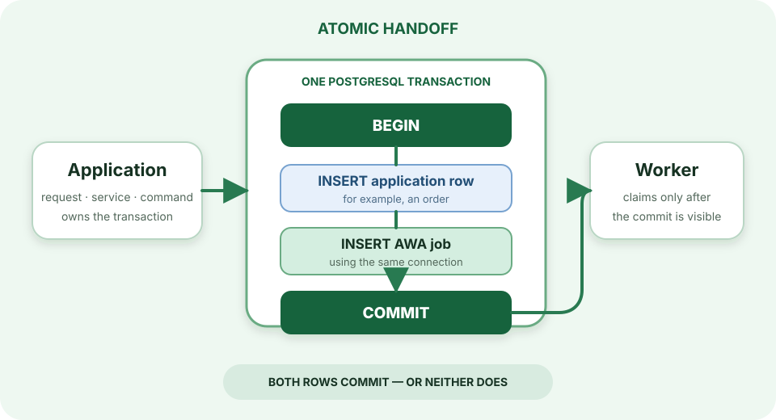

> For the complete AWA documentation index, see [`llms.txt`](../../llms.txt).

# Transactional enqueue

The central reason to keep AWA in PostgreSQL is atomic handoff. An application write and the job that follows it can commit together.

<div class="awa-diagram" markdown>

</div>

Without atomic enqueue, an application can commit business data and crash before publishing work—or publish work and then roll back the data the handler expects. AWA avoids that gap by accepting the application's existing database transaction.

## Rust

Pass an open `sqlx` transaction to the same insertion functions used with a pool:

```rust
let mut tx = pool.begin().await?;

sqlx::query("INSERT INTO orders (id, email) VALUES ($1, $2)")
    .bind(order_id)
    .bind(email)
    .execute(&mut *tx)
    .await?;

awa::insert_with(&mut *tx, &SendEmail { to: email.into() }, options).await?;
tx.commit().await?;
```

## Python

Use `awa.bridge` with the connection or session that owns the application transaction:

```python
async with session.begin():
    await session.execute(insert(Order).values(id=order_id, email=email))
    await awa.bridge.insert_job(
        session,
        SendEmail(to=email),
        queue="email",
    )
```

The bridge supports asyncpg, psycopg 3, SQLAlchemy, and Django. It does not move transaction ownership into AWA: the application still decides whether to commit or roll back. See [Bridge adapters](../../bridge-adapters/index.md) for exact driver behavior and tested examples.

!!! warning "Atomic enqueue does not make arbitrary side effects exactly once"
    AWA commits the job atomically with data in the same PostgreSQL transaction. A handler calling an external API still needs an idempotency key or another duplicate-safe design because delivery is at least once.

## Isolation levels

Enqueue works at every isolation level, and `READ COMMITTED`, PostgreSQL's default, is the simplest to run with.

From migration v062 (0.7), an enqueue in a `REPEATABLE READ` or `SERIALIZABLE` transaction keeps its lane's jobs in order even when the transaction's snapshot predates a queue-ring rotation. Before v062, and on 0.6, such an enqueue could land in an older ring generation, where claims skipped it and prune deleted it ([#847](https://github.com/hardbyte/awa/issues/847)). While any producer from before v062 still enqueues, keep `REPEATABLE READ` and `SERIALIZABLE` producers on `READ COMMITTED`; the [upgrade guide](../../upgrade-0.6-to-0.7/index.md) has the details.

At `REPEATABLE READ` or `SERIALIZABLE`, expect PostgreSQL to abort some transactions with a serialization failure (SQLSTATE `40001`) and retry the whole transaction when it does:

- An enqueue updates shared rows, such as its lane's head, that concurrent producers also update, so two enqueues to the same lane can conflict.
- A race on a unique job key can fail with `40001` rather than a unique-key conflict, so handle both.

In Rust, `AwaError::is_serialization_failure()` identifies the failure. In Python it comes from your driver: psycopg's `errors.SerializationFailure`, asyncpg's `SerializationError`, or a Django `OperationalError` whose cause has SQLSTATE `40001`.

Workers are not affected by the level your producers use. Every transaction awa opens to write runs at `READ COMMITTED`, whatever the session default. A few read-only reads, such as loading a page of jobs, name `REPEATABLE READ, READ ONLY` to see one consistent snapshot; a transaction it hands to your code, such as the Python client's `transaction()`, keeps the session default. Single statements it runs outside a transaction, such as heartbeats, take the session's `default_transaction_isolation`. If a role or database default is above `READ COMMITTED`, give the worker pool's connections `default_transaction_isolation = 'read committed'`, for example with `PgConnectOptions::options`. The worker logs a warning at start when the default is higher.
