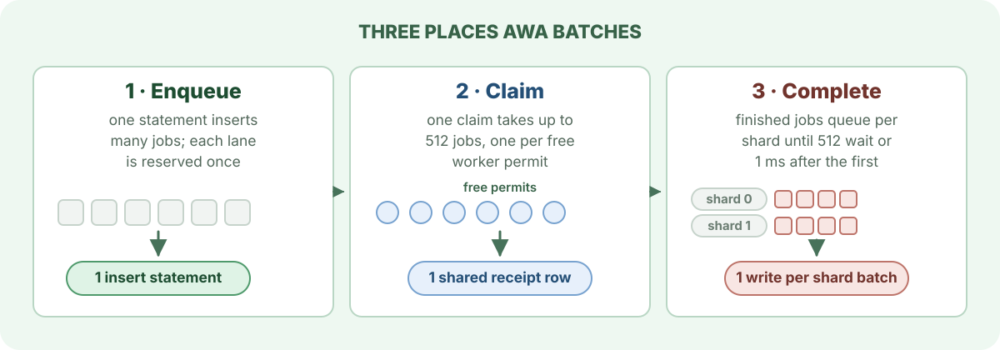

# Batching

Every statement AWA sends costs a round trip, and every transaction that commits costs a WAL flush. At thousands of jobs a second those fixed costs dominate, so AWA handles jobs in groups at the three points where a job touches the database most.

Batching changes how many jobs share a statement, not what happens to each one. Every job in a batch still gets its own lane position, its own `run_lease` and its own outcome, and every write for an attempt is still checked against that attempt's `run_lease`.

## Enqueue: many jobs, one statement

A batch insert writes all its jobs in one statement inside the caller's transaction, so they commit or roll back together. It reserves each [lane](lanes-and-claiming.md) it touches once for the whole batch, in a fixed lane order, so two batches that share lanes cannot lock them in opposite orders.

| API | Path | Use it for |
| --- | --- | --- |
| `QueueStorage::enqueue_params_copy` (Rust), `enqueue_many_copy` (Python) | writes straight into queue storage; array insert below 2,048 rows, `COPY` from there up | bulk producers on queue storage |
| `insert_many_copy`, `insert_many_skip_unique_conflicts` | the batch insert function, which can skip unique-key conflicts in the same statement | the compatibility insert API |
| `insert_many` | one statement that inserts each row in turn | small batches inside an existing transaction |

The lane locks a batch takes are held until its transaction commits. A large batch in a long transaction holds every lane it touched for that long, and other producers on those lanes wait behind it. Commit large batches promptly, or split them.

Direct producers must use the same queue-storage settings as the workers, in particular the stripe count; see [Producer path choice](../configuration.md#producer-path-choice).

## Claim: one round trip per batch

Before it claims, a dispatcher takes worker permits: one for each job it is prepared to run, up to `claim_batch_size` (512 by default). It then claims that many jobs in one transaction and writes one receipt row that lists them all. Every claimed job already has a worker waiting for it, so no claimed job sits in memory without capacity to run.

The jobs in one claim share a claim time, and therefore a deadline. A queue whose workers are mostly busy claims small batches, because it only has a few permits free; a queue with idle workers and a backlog claims in large ones.

Lower `claim_batch_size` for a small queue where latency matters more than throughput. Each runtime also limits how many claims run at once (`max_concurrent_claims`, a quarter of the pool by default), so many queues polling together do not open hundreds of transactions.

## Complete: one write per shard batch

A finished attempt goes to completion shard `job_id mod AWA_COMPLETION_SHARDS`. Each shard collects attempts until 512 are waiting (`AWA_COMPLETION_BATCH_SIZE`) or none has arrived for 1 ms (`AWA_COMPLETION_FLUSH_MS`), then writes them in one statement. For successful short jobs that statement closes their receipts and appends one compact terminal row for the whole batch.

The worker slot is freed when the handler returns, not when its completion commits, so a slow commit does not hold a worker. To bound memory, a runtime lets at most the larger of its worker capacity and `2 × batch size × shards` finished attempts wait to be written; beyond that, a handler that returns keeps its worker until a completion commits. A runtime whose completions fall behind therefore claims more slowly instead of piling up results.

If the database is unreachable, a finished attempt keeps its result and retries the write for up to two minutes; see [claims, receipts and leases](claims-receipts-and-leases.md#when-a-worker-loses-the-database).

## Tuning

The defaults suit most workloads. Measure durable completions per second, end-to-end p99 and WAL bytes per completed job before and after any change.

| Setting | Default | Raise when | Lower when |
| --- | --- | --- | --- |
| `claim_batch_size` | 512 | rarely needed | a small queue needs low latency |
| `max_concurrent_claims` | a quarter of the pool, 4 to 64 | many hot queues share one runtime | the database shows lock-manager contention |
| `AWA_COMPLETION_SHARDS` | 1, or 4 at 512+ workers | one runtime has very high worker capacity | completions from many runtimes contend |
| `AWA_COMPLETION_BATCH_SIZE` | 512 | rarely needed | payloads are large and memory matters |
| `AWA_COMPLETION_FLUSH_MS` | 1 | rarely needed | rarely needed |

## Related

- [Scaling a hot queue](scaling-a-hot-queue.md): when batching is not enough for one queue.
- [Configuration: queue storage tuning](../configuration.md#queue-storage-tuning): every setting in detail.
