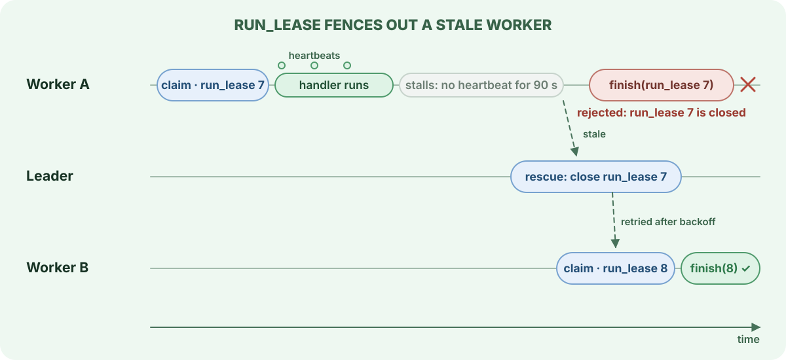
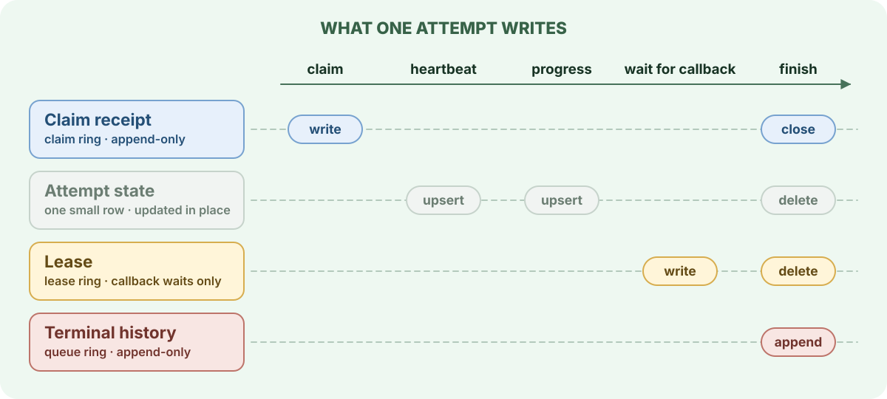

# Claims, receipts and leases

A claim hands one attempt of a job to one worker. AWA records that ownership with as little storage as the attempt needs: a short attempt only appends rows, a longer one also keeps one small row for its heartbeat and progress, and only an attempt that registers an external callback gets a lease.

## `run_lease`: the attempt's number

Every claim increments the job's `run_lease`. Every later write for that attempt (heartbeat, progress, completion, retry, snooze, cancel, callback) names the job and its `run_lease`, and is applied only if that attempt is still open. A write for a closed attempt changes nothing.

This is what makes rescue safe. Worker A in the diagram is not dead; it is paused, partitioned or slow. When it wakes and tries to finish, the attempt it names has already been closed and the job belongs to a newer attempt, so its result is discarded.

`run_lease` protects the database, not the outside world. Anything worker A did before it stalled, such as sending an email or charging a card, has still happened. Make those effects idempotent; [transactional enqueue](transactional-enqueue.md) and the [failure lab](failure-lab.md) show how.

## What an attempt writes

**Claim receipt.** The claim appends one receipt row per claim batch to the current slot of the claim ring, listing every job, `run_lease` and receipt id in the batch. It is never updated. When an attempt ends, closure evidence is appended in the same claim slot: successful short jobs share one closure batch row per completion batch, and other outcomes, rescue and cancellation append a closure row of their own. An attempt is open while its receipt has neither.

**Attempt state.** The first heartbeat or progress update creates a small row for the attempt, and later ones update it. It holds the heartbeat time and the latest progress, and is deleted when the attempt finishes. A job that finishes before its first heartbeat never creates one.

**Lease.** An attempt that waits for a callback needs state that changes while no handler is running: the callback id, its timeout and the waiting state. Registering the callback creates a lease row in the lease ring, while the handler is still running, and the callback or a timeout later resolves it. With `lease_claim_receipts` turned off, every claim writes a lease instead of a receipt.

**Terminal history.** Finishing appends the outcome to the queue ring, in the same slot as the job's ready row. Successful short jobs share one compact row per completion batch. Read finished jobs through `terminal_jobs` or the admin API, not the physical tables.

The common path, claim then finish, therefore only appends rows to partitions that are later truncated whole. That keeps the hot tables free of dead rows; see [rings](rings.md).

## Heartbeats

While a handler runs, its worker heartbeats each attempt it holds, every `heartbeat_interval` (30 s by default). Heartbeats come from a task on the worker's async runtime, not from the handler. A Python handler that blocks, or a Rust handler that awaits a long operation, still keeps its attempt alive. A Rust handler that blocks the runtime's threads stops heartbeats too and its attempt can be rescued while it runs, so run blocking work with `spawn_blocking` and give it a timeout.

A heartbeat proves the process is alive; it does not extend the queue's `deadline_duration`, which bounds the attempt however healthy the worker is. A queue with `deadline_duration` set to zero has no deadline, and a hung handler holds its attempt for as long as its worker keeps heartbeating.

## Rescue

The maintenance leader closes attempts that can no longer finish on their own:

| Rescue | Triggers when | Default |
| --- | --- | --- |
| Stale heartbeat | the attempt's last heartbeat, or its claim if it never heartbeated, is older than `heartbeat_staleness` | 90 s |
| Deadline | the attempt has run longer than the queue's `deadline_duration`, unless that is zero | per queue |
| Callback timeout | a callback wait passed its timeout | per callback |

Rescue closes the attempt and then sends the job down the normal path: back to deferred jobs for a retry if attempts remain, otherwise to `failed` or the dead-letter queue. The rescued attempt counts against `max_attempts`, which is how a job that crashes its worker every time eventually stops; see [poison jobs](job-lifecycle.md#poison-jobs).

Rescue takes the same per-attempt lock as completion, so an attempt that finishes at the moment rescue examines it is either completed or rescued, never both.

## When a worker loses the database

A worker that finished a handler but cannot reach the database keeps the result and retries the write for up to two minutes. If the connection comes back, the job completes without running again. If rescue closed the attempt in the meantime, the saved result is discarded by the `run_lease` check like any other stale write.

## Related

- [Lanes and claiming](lanes-and-claiming.md): which job a claim picks.
- [Rings: rotation and prune](rings.md): when receipts, leases and terminal rows are reclaimed.
- [Configuration: reliability timings](../configuration.md#reliability-timings-heartbeat-deadline-rescue): heartbeat, deadline and rescue settings.
- [ADR-013](../adr/013-run-lease-and-guarded-finalization.md) and [ADR-023](../adr/023-receipt-plane-ring-partitioning.md): the design records.
