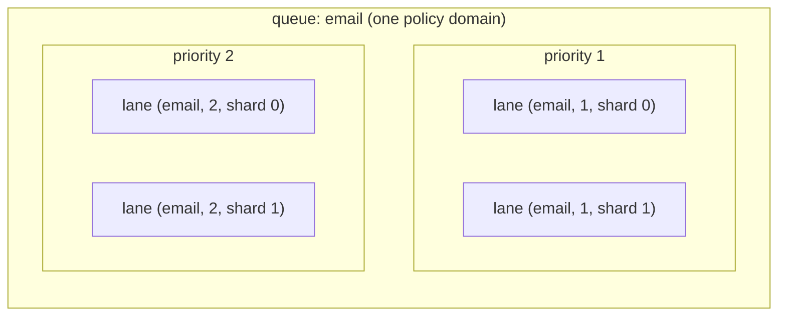

# Queues, lanes and splitting work

AWA gives you several ways to divide work: separate queues, priorities, enqueue shards, partitioned queues, claimers and queue stripes. They are not interchangeable. Each one changes a different part of what a queue is, so each solves a different problem and gives up something different. This page builds up what a queue is from first principles, then says what each tool changes, which to reach for, and which combine.

## Why a Postgres queue has contention points

A job queue in PostgreSQL is a table that many producers write to and many workers read from. Two promises make it useful, and both need coordination:

- **Order.** If producer A commits job 1 before producer B commits job 2, a worker should not run job 2 first. Rows become visible in commit order, not in the order their sequence numbers were handed out, so something has to stop a later number from becoming visible while an earlier one might still commit.
- **Exactly one claimer per attempt.** Two workers must not both take the same job. Something has to record "taken up to here" so the next worker starts after it.

AWA does both with one small piece of state per ordered sequence of jobs, called a **lane**. A producer holds the lane's enqueue lock from the moment it reserves positions until it commits, so positions become visible in order. A worker locks the lane's claim cursor while it reads the next jobs and moves the cursor past them. Those two locks are where producers and workers meet, and therefore where they wait for each other under load. The database can have plenty of CPU and I/O left while every producer for one lane is queued behind that lane's lock.

[Lanes and claiming](lanes-and-claiming.md) describes the mechanism in detail. For this page, the point is: **one lane admits one producer and one claimer at a time.** Every scaling tool below either adds lanes, adds whole queues, or adds claim loops over lanes that already exist.

## What a queue is

A queue in AWA plays three roles at once.

| Role | What it covers | Set by |
| --- | --- | --- |
| **Policy domain** | Worker capacity (`max_workers`, or `min_workers` and `weight` in weighted mode), `rate_limit`, `deadline_duration`, priority aging, retention, dead-letter queue enablement, and the metrics and admin views labelled with the queue name | `QueueConfig` and builder settings in each worker process |
| **Ordering domain** | A set of lanes, one per `(queue, priority, enqueue_shard)`. Jobs come out in order within a lane; across lanes, a claim prefers the lane whose head has the best effective priority | The job's `queue` and `priority`, and the queue's `enqueue_shards` |
| **Coordination points** | Each lane's enqueue lock and claim cursor lock | Follows from the lanes |



Policy is applied by each worker process to the queues it serves. `max_workers` is a semaphore and `rate_limit` is a token bucket inside one runtime, shared by that runtime's claim loops for the queue. Three worker processes each configured with `max_workers: 20` and a rate of 50 per second for `email` allow up to 60 concurrent jobs and 150 jobs per second across the fleet. Divide the per-process values by the replica count when you need a fleet-wide cap.

## The tools

Each tool below is described by which of the three roles it changes.

### Separate queues

A new queue is a new policy domain with its own lanes. The producer chooses the queue when it enqueues.

```rust
awa::insert_with(&pool, &SendWebhook { url, body },
    InsertOpts { queue: "webhooks".into(), ..Default::default() }).await?;
```

```python
await client.insert(SendWebhook(url=url, body=body), queue="webhooks")
```

- **You get:** isolation. A slow or failing `webhooks` handler cannot use `email`'s worker slots, rate limit or deadline. Each queue can run on its own worker processes, scale separately and be paused or drained on its own. Job kinds with very different run times belong on different queues so short jobs do not wait behind long ones; see [Sizing workers from utilization](../configuration.md#sizing-workers-from-utilization).
- **You give up:** nothing is ordered across queues, and the caller has to know which queue a job belongs on.
- **Contention:** each queue has its own lanes, so two queues never share an enqueue or claim lock.

Use separate queues when work needs different policy. Do not use them only to spread load for one kind of work; that is what shards and partitions are for.

### Priority

Priority (1 to 4, default 2) adds lanes inside the same queue. All priorities share the queue's policy.

```rust
InsertOpts { queue: "email".into(), priority: 1, ..Default::default() }
```

```python
await client.insert(SendEmail(to=to, subject=subject), queue="email", priority=1)
```

- **You get:** urgent work runs ahead of bulk work on the same workers. Priority aging improves a waiting job's effective priority over time so low-priority work is not starved; see [Job priority and aging](../configuration.md#job-priority-and-aging).
- **You give up:** jobs at different priorities are ordered by effective priority, not by enqueue time, and priority 1 work shares capacity and rate limit with everything else on the queue.
- **Contention:** each priority is its own lane, so producers at different priorities do not wait on each other. This is a side effect; priority is not a scaling tool.

### Enqueue shards

`enqueue_shards` (1 to 64, default 1) splits each priority of one queue into several lanes. It is a per-queue setting stored in `awa.queue_meta`:

```sql
INSERT INTO awa.queue_meta (queue, enqueue_shards)
VALUES ('email', 4)
ON CONFLICT (queue) DO UPDATE SET enqueue_shards = EXCLUDED.enqueue_shards;
```

A job with an `ordering_key` goes to the shard its key hashes to, so jobs with the same key stay in order. Jobs without a key are spread across the shards.

```rust
InsertOpts {
    queue: "billing".into(),
    ordering_key: Some(format!("account-{account_id}").into_bytes()),
    ..Default::default()
}
```

```python
await client.insert(ChargeAccount(account_id=account_id), queue="billing",
                    ordering_key=f"account-{account_id}")
```

- **You get:** more producers and claimers can work on one queue at the same time, because there are more enqueue locks and claim cursors. One claim still compares all of the queue's lanes, so priority works across shards. The queue stays one name with one policy.
- **You give up:** FIFO across the whole queue. Order holds within a shard, and per key when you pass `ordering_key`. Jobs without a key have no order relative to jobs on other shards.
- **Policy:** unchanged. Capacity and rate limit still apply to the queue as a whole.
- **Changing it:** lowering the count is safe at any time; existing jobs on higher shards are still claimed. Raising or lowering it moves keys to different shards, so a key's jobs enqueued before and after the change can run out of order until the older ones drain. A producer process that enqueues directly into queue storage keeps the shard count it first read until it restarts; the SQL insert path reads it on every insert.

See [Sharding the enqueue head](../configuration.md#sharding-the-enqueue-head-per-queue) and [ADR-025](../adr/025-sharded-enqueue-heads.md).

### Partitioned queues

`PartitionedQueue` turns one logical workload into N ordinary queues, named `email`, `email__p1`, `email__p2` and so on, and routes each job to one of them. Routing by key keeps a key's jobs in one partition and sets the job's `ordering_key` too.

```rust
let billing = PartitionedQueue::new("billing", 4)?;

let client = Client::builder(pool.clone())
    .partitioned_queue(&billing, QueueConfig { max_workers: 16, ..Default::default() })
    .register::<ChargeAccount, _, _>(charge_account)
    .build()?;

let opts = billing.route_opts_by_key(InsertOpts::default(), format!("account-{account_id}"));
awa::insert_with(&pool, &ChargeAccount { account_id }, opts).await?;
```

```python
billing = awa.PartitionedQueue("billing", 4)

await client.start(billing.queue_configs(max_workers_per_partition=16))

await client.insert(ChargeAccount(account_id=account_id),
                    **billing.route_by_key(f"account-{account_id}"))
```

- **You get:** N policy domains and N sets of lanes. Each partition has its own capacity, rate limit, claim path, completion stream and metrics, so a burst of one key's work fills one partition rather than the whole workload. `route_by_index` / `route_opts_by_index` spread work round-robin when you do not need per-key order.
- **You give up:** one queue in the admin views and metrics; operators see N queues. Capacity and rate limit multiply: four partitions with `max_workers: 16` and a rate of 50 per second allow 64 workers and 200 jobs per second per process. Divide the values, or use weighted mode with `global_max_workers`, for a total cap. Retention and dead-letter overrides are keyed by queue name, so set them for each partition. Priority is compared only within a partition.
- **Changing it:** changing N moves keys to different partitions. Grow workers before producers; shrink producers first and drain the removed partitions before stopping their workers. See [ADR-031](../adr/031-partitioned-queues.md).

See [Partitioned queues](../configuration.md#partitioned-queues).

### Claimers

`claimers` (default 1) runs more claim loops for one queue inside one worker process. It adds no lanes and no policy domains: the loops share the queue's worker slots and rate limiter, and take turns on the same lanes.

```rust
.queue("email", QueueConfig { max_workers: 64, claimers: 2, ..Default::default() })
```

```python
await client.start([{"name": "email", "max_workers": 64, "claimers": 2}])
```

- **You get:** more claim round trips in flight when one loop cannot keep the process's workers busy.
- **You give up:** more database transactions per claimed job. In measured hot-queue shapes, more claimers made tail latency worse. A larger `claim_batch_size` is usually the better first step.

### Queue stripes

`queue_stripe_count` (Rust `QueueStorageConfig::queue_stripe_count`, Python `queue_storage_queue_stripe_count`, default 1) is a storage setting for the whole fleet. It splits every logical queue `q` into physical queues `q#0` to `q#N-1`, each with its own lanes. Producers and workers must use the same count.

- **You get:** more lanes for every queue, without changing the queue's policy. Capacity and rate limit are configured on the logical queue and shared across its stripes.
- **You give up:** order across stripes, and priority across stripes: a claim visits the stripes in turn, so a priority 1 job on one stripe can wait while lower-priority jobs on another stripe are claimed. The setting applies to every queue, not just the hot one. Shard counts in `awa.queue_meta` are read per stripe, so a striped queue's shard count is set on each `q#N`.
- **Routing:** from 0.6.18, a direct queue-storage enqueue puts a job on the stripe its `ordering_key` hashes to, else its unique key's stripe, and rotates other jobs across stripes. Jobs inserted through the SQL insert path, cron and handler follow-ups go to the unstriped `q`, and striped workers claim from `q` as well as its stripes ([#749](https://github.com/hardbyte/awa/issues/749)).

Enqueue shards cover the same need per queue, with per-key order and without fleet-wide agreement on a setting. Stripes are planned for deprecation in 0.7 in favour of shards and partitioned queues ([#752](https://github.com/hardbyte/awa/issues/752)). Do not adopt them for new deployments.

## Decision guide

| I need | Use | Why |
| --- | --- | --- |
| Different capacity, rate limit, deadline, retention or DLQ policy for some work | Separate queues | Policy is per queue |
| A slow or failing kind of work not to hold up another | Separate queues, served by separate worker processes if needed | Separate worker slots and lanes |
| Urgent work to run ahead of bulk work on the same workers | Priority | More lanes, same policy, ordered by effective priority |
| More enqueue or claim throughput on one queue, keeping one queue name | `enqueue_shards` | More lanes in the same policy domain |
| Order per customer, account or order, with more throughput | `enqueue_shards` or `PartitionedQueue`, with an `ordering_key` | Same key, same lane |
| Capacity or rate limit per slice of one workload, or a busy key not to fill the whole workload | `PartitionedQueue` | Each partition is a full queue |
| Workers sitting idle while the queue has a backlog | A larger `claim_batch_size`, then `claimers` | More jobs per claim, then more claim loops |
| Strict FIFO across the whole queue | One queue, one priority, `enqueue_shards = 1` | One lane is the only total order |

Before splitting a queue, check that it is short of lane throughput rather than of workers. A queue whose utilization stays above about 0.8 needs more workers; shards, stripes and claimers add none. See [Scaling a hot queue](scaling-a-hot-queue.md#which-to-try-first) for the order to try them in and how to measure the result.

## What combines

| Combination | Result | Notes |
| --- | --- | --- |
| Separate queues + anything | Composes | Each queue is configured independently; shards, partitions and claimers apply per queue |
| Priority + `enqueue_shards` | Composes | Lanes are `priorities × shards`; a claim compares effective priority across all of them |
| Priority + `PartitionedQueue` | Composes, priority per partition | A priority 1 job in one partition does not run ahead of a priority 2 job in another |
| `PartitionedQueue` + `enqueue_shards` | Composes | Each partition can raise its own shard count. Key routing sets `ordering_key`, and the partition and shard hashes are independent, so a key keeps one partition and one shard while a partition's keys still use all its shards |
| `enqueue_shards` + `ordering_key` | Composes | Per-key FIFO within the queue; `ordering_key` is ignored at one shard |
| `claimers` + `enqueue_shards` | Composes | More lanes reduce the chance that claim loops skip each other's locked lanes; measure before raising claimers |
| `claimers` + `PartitionedQueue` | Composes, multiplies | Claimers apply to each partition, multiplying claim loops and transactions |
| `queue_stripe_count` + `enqueue_shards` | Overlap | Both add lanes to spread the same locks; lanes become `stripes × priorities × shards`. Prefer shards alone |
| `queue_stripe_count` + `PartitionedQueue` | Overlap | Every partition is striped too, since stripes apply to every queue |
| Strict global FIFO + shards, stripes or partitions | Conflict | Each of these gives up order across lanes; only per-key order survives, and only with an `ordering_key` |

Rate limit and capacity differ by tool. With separate queues and `PartitionedQueue`, each queue or partition has its own `max_workers` and `rate_limit`. With priority, `enqueue_shards`, claimers and stripes, the queue keeps one `max_workers` and one `rate_limit` across all its lanes. In every case the values apply per worker process.

## Read next

- [Lanes and claiming](lanes-and-claiming.md): how a lane orders jobs, and what enqueue and claim lock.
- [Scaling a hot queue](scaling-a-hot-queue.md): which lever to try first, and how to measure it.
- [Queue configuration](../configuration.md#queue-configuration): every `QueueConfig` field, in Rust and Python.
- [ADR-025: sharded enqueue heads](../adr/025-sharded-enqueue-heads.md) and [ADR-031: partitioned queues](../adr/031-partitioned-queues.md): design records.
