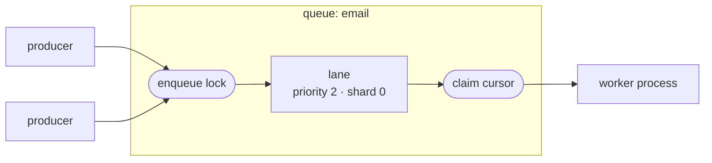
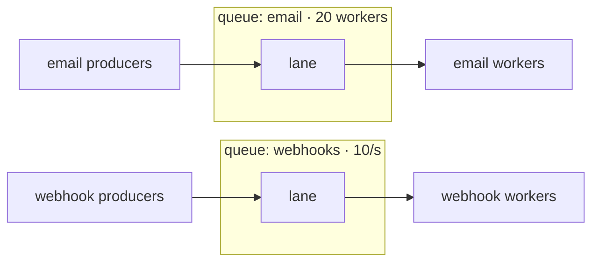
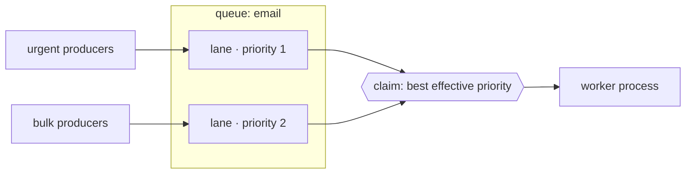
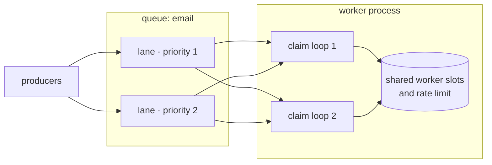
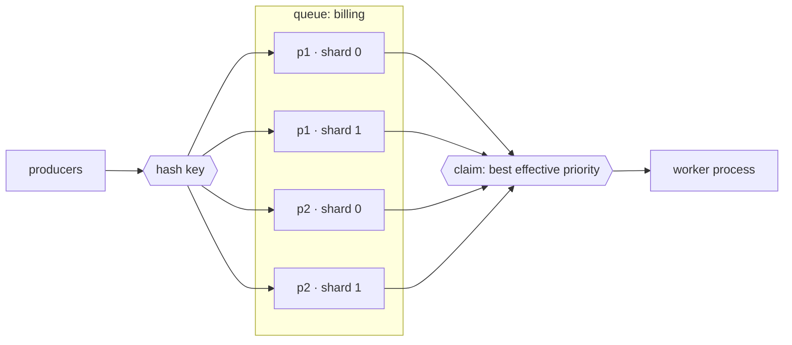
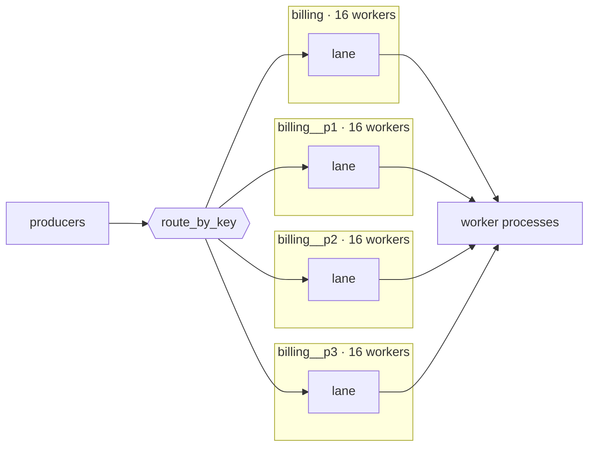

# Queues, lanes and splitting work

AWA gives you several ways to divide work: separate queues, priorities, claimers, enqueue shards and partitioned queues. They are not interchangeable: each one solves a different problem and gives up something different. This page starts from the simplest queue and adds one tool at a time, each when a specific problem calls for it. It ends with a decision guide and a table of which tools combine.

## One queue, one lane

A producer appends jobs to a **lane**, an ordered sequence of jobs, and workers claim jobs from the lane's head. A lane belongs to one `(queue, priority, enqueue_shard)`, so a queue whose jobs all use the default priority and the default single shard has exactly one lane.



A lane has two coordination points. A producer holds the lane's **enqueue lock** from the moment it reserves positions until it commits, so a later position can never become visible while an earlier one might still commit. A worker locks the lane's **claim cursor** while it reads the next jobs and moves the cursor past them, so no two workers take the same job. One lane therefore admits one producer and one claimer at a time, and that is what makes its jobs come out in commit order. [Lanes and claiming](lanes-and-claiming.md) describes both steps in detail.

The queue name also carries policy: worker capacity (`max_workers`, or `min_workers` and `weight` in weighted mode), `rate_limit`, `deadline_duration`, priority aging, retention, dead-letter queue enablement, and the metrics and admin views labelled with the queue name. Each worker process applies the policy itself. `max_workers` is a semaphore and `rate_limit` is a token bucket inside one runtime, so three worker processes each configured with `max_workers: 20` and a rate of 50 per second allow up to 60 concurrent jobs and 150 jobs per second across the fleet. Divide the per-process values by the replica count when you need a fleet-wide cap.

Most queues never need more than this. Each section below starts from a problem this queue runs into and adds one tool to solve it.

## Unrelated work: a separate queue

**Problem:** webhook deliveries call a slow third party that allows 10 requests per second, and they share the `email` queue. A backlog of webhooks takes worker slots that email needs, and email's rate limit and deadline are wrong for webhooks.

A separate queue has its own policy and its own lanes. The producer chooses the queue when it enqueues.



```rust
awa::insert_with(&pool, &SendWebhook { url, body },
    InsertOpts { queue: "webhooks".into(), ..Default::default() }).await?;
```

```python
await client.insert(SendWebhook(url=url, body=body), queue="webhooks")
```

- **You get:** isolation. A slow or failing `webhooks` handler cannot use `email`'s worker slots, rate limit or deadline. Each queue can run on its own worker processes, scale separately and be paused or drained on its own. The two queues never share an enqueue lock or claim cursor.
- **You give up:** nothing is ordered across queues, and the producer has to know which queue a job belongs on.

Put job kinds with very different run times on separate queues too, so short jobs do not wait behind long ones; see [Sizing workers from utilization](../configuration.md#sizing-workers-from-utilization). Do not add queues only to spread the load of one kind of work: claimers, shards and partitions below do that without splitting its policy by accident.

## Urgent work: priority

**Problem:** a password-reset email waits behind 50,000 newsletter emails on the same queue and the same workers.

Priority (1 to 4, default 2) adds a lane per priority inside the same queue. All priorities share the queue's policy. A claim takes from the lane whose head has the best effective priority.



```rust
InsertOpts { queue: "email".into(), priority: 1, ..Default::default() }
```

```python
await client.insert(SendEmail(to=to, subject=subject), queue="email", priority=1)
```

- **You get:** urgent work runs ahead of bulk work on the same workers. Priority aging improves a waiting job's effective priority over time, so low-priority work is not starved; see [Job priority and aging](../configuration.md#job-priority-and-aging).
- **You give up:** jobs at different priorities are ordered by effective priority, not by enqueue time. Priority 1 work still shares capacity and rate limit with everything else on the queue.

Producers at different priorities use different lanes, so they do not wait on each other's enqueue lock. That is a side effect: priority is not a scaling tool.

## Idle workers with a backlog: claimers

**Problem:** the queue has a backlog, but the worker process has free worker slots. One claim loop, waiting on a database round trip per claim, cannot hand out jobs as fast as the workers finish them.

Try a larger `claim_batch_size` first, so each claim takes more jobs. If one loop still leaves workers idle, `claimers` (default 1) runs more claim loops for the queue in each worker process. Claimers add no lanes and no policy: the loops share the queue's worker slots and rate limiter and take turns on the same lanes.



```rust
.queue("email", QueueConfig { max_workers: 64, claimers: 2, ..Default::default() })
```

```python
await client.start([{"name": "email", "max_workers": 64, "claimers": 2}])
```

- **You get:** more claims in flight when one loop cannot keep the process's workers busy.
- **You give up:** more database transactions per claimed job. A claim loop that finds a lane's cursor locked by another loop skips that lane, so with few lanes the extra loops mostly skip each other. In measured hot-queue shapes, more claimers made tail latency worse.

## Producers waiting on one lane: enqueue shards

**Problem:** many producers write to one queue at one priority. Each waits for the producer ahead of it to commit and release the lane's enqueue lock, and claims queue behind one claim cursor, while the database still has CPU and I/O to spare.

`enqueue_shards` (1 to 64, default 1) splits each priority of one queue into several lanes. Each shard has its own enqueue lock and claim cursor, and one claim still compares the effective priority of every lane in the queue. The count is a per-queue setting in `awa.queue_meta`:

```sql
INSERT INTO awa.queue_meta (queue, enqueue_shards)
VALUES ('billing', 2)
ON CONFLICT (queue) DO UPDATE SET enqueue_shards = EXCLUDED.enqueue_shards;
```



A job with an `ordering_key` goes to the shard its key hashes to, so jobs with the same key stay in order. Jobs without a key are spread across the shards.

```rust
InsertOpts {
    queue: "billing".into(),
    ordering_key: Some(format!("account-{account_id}").into_bytes()),
    ..Default::default()
}
```

```python
await client.insert(ChargeAccount(account_id=account_id), queue="billing",
                    ordering_key=f"account-{account_id}")
```

- **You get:** more producers and claimers working on one queue at the same time. The queue keeps one name, one policy and one set of metrics.
- **You give up:** FIFO across the whole queue. Order holds within a shard, and per key when you pass `ordering_key`. Jobs without a key have no order relative to jobs on other shards.
- **Changing it:** lowering the count never strands jobs; workers still claim the ones on higher shards. Changing the count in either direction moves keys to different shards, so a key's jobs enqueued before and after the change can run out of order until the older ones drain. A producer that enqueues directly into queue storage keeps the count it first read until it restarts; the SQL insert path reads it on every insert.

[Scaling a hot queue](scaling-a-hot-queue.md) has measured throughput for each shard count and how to confirm the change helped. See also [Sharding the enqueue head](../configuration.md#sharding-the-enqueue-head-per-queue) and [ADR-025](../adr/025-sharded-enqueue-heads.md).

## One slice needs its own limits: partitioned queues

**Problem:** one workload, such as charging customer accounts, needs to be split so each part has its own worker capacity and rate limit. Or one busy account enqueues so much that its jobs take every worker on the queue, and other accounts wait behind it.

`PartitionedQueue` turns one logical workload into N ordinary queues, named `billing`, `billing__p1`, `billing__p2` and so on, and routes each job to one of them. Each partition is a complete queue with its own policy and lanes. Routing by key keeps a key's jobs in one partition and also sets the job's `ordering_key`.



```rust
let billing = PartitionedQueue::new("billing", 4)?;

let client = Client::builder(pool.clone())
    .partitioned_queue(&billing, QueueConfig { max_workers: 16, ..Default::default() })
    .register::<ChargeAccount, _, _>(charge_account)
    .build()?;

let opts = billing.route_opts_by_key(InsertOpts::default(), format!("account-{account_id}"));
awa::insert_with(&pool, &ChargeAccount { account_id }, opts).await?;
```

```python
billing = awa.PartitionedQueue("billing", 4)

await client.start(billing.queue_configs(max_workers_per_partition=16))

await client.insert(ChargeAccount(account_id=account_id),
                    **billing.route_by_key(f"account-{account_id}"))
```

- **You get:** N sets of policy and lanes. Each partition has its own capacity, rate limit, claim path, completion stream and metrics, so a burst of one key's work fills one partition rather than the whole workload. `route_by_index` and `route_opts_by_index` spread work round-robin when you do not need per-key order.
- **You give up:** one queue in the admin views and metrics; operators see N queues. Keys that share a partition with a busy key still wait behind it. Capacity and rate limit multiply: four partitions with `max_workers: 16` and a rate of 50 per second allow 64 workers and 200 jobs per second in each worker process. Divide the values, or use weighted mode with `global_max_workers`, for a total cap. Retention and dead-letter overrides are keyed by queue name, so set them for each partition. Priority is compared only within a partition.
- **Changing it:** changing N moves keys to different partitions. Start workers for new partitions before producers route to them; when shrinking, move producers first and drain the removed partitions before stopping their workers. See [ADR-031](../adr/031-partitioned-queues.md).

See [Partitioned queues](../configuration.md#partitioned-queues) for the full API.

## Decision guide

| I need | Use | Why |
| --- | --- | --- |
| Different capacity, rate limit, deadline, retention or DLQ policy for some work | Separate queues | Policy is per queue |
| A slow or failing kind of work not to hold up another | Separate queues, served by separate worker processes if needed | Separate worker slots and lanes |
| Urgent work to run ahead of bulk work on the same workers | Priority | A lane per priority, same policy, ordered by effective priority |
| Workers sitting idle while the queue has a backlog | A larger `claim_batch_size`, then `claimers` | More jobs per claim, then more claim loops |
| More enqueue or claim throughput on one queue, keeping one queue name | `enqueue_shards` | More lanes under the same policy |
| Order per customer, account or order, with more throughput | `enqueue_shards` or `PartitionedQueue`, with an `ordering_key` | Same key, same lane |
| Capacity or rate limit per slice of one workload, or a busy key not to fill the whole workload | `PartitionedQueue` | Each partition is a complete queue |
| Strict FIFO across the whole queue | One queue, one priority, `enqueue_shards = 1` | One lane is the only total order |

Before splitting a queue, check that it is short of lane throughput rather than of workers. A queue whose utilization stays above about 0.8 needs more workers, and shards and claimers add none. [Scaling a hot queue](scaling-a-hot-queue.md#which-to-try-first) gives the order to try the throughput tools in and how to measure the result.

## What combines

| Combination | Result | Notes |
| --- | --- | --- |
| Separate queues + anything | Composes | Each queue is configured independently; priority, claimers, shards and partitions apply per queue |
| Priority + `enqueue_shards` | Composes | Lanes are `priorities × shards`; a claim compares effective priority across all of them |
| Priority + `PartitionedQueue` | Composes, priority per partition | A priority 1 job in one partition does not run ahead of a priority 2 job in another |
| `claimers` + `enqueue_shards` | Composes | More lanes mean claim loops skip each other's locked lanes less often; measure before raising claimers |
| `claimers` + `PartitionedQueue` | Composes, multiplies | Claimers apply to each partition, multiplying claim loops and transactions |
| `enqueue_shards` + `ordering_key` | Composes | Per-key FIFO within the queue; `ordering_key` has no effect at one shard |
| `PartitionedQueue` + `enqueue_shards` | Composes | Each partition can raise its own shard count. Key routing sets `ordering_key`, and the partition and shard hashes are independent, so a key keeps one partition and one shard while a partition's keys still use all its shards |
| Strict global FIFO + shards or partitions | Conflict | Both give up order across lanes; only per-key order survives, and only with an `ordering_key` |

Rate limit and capacity differ by tool. With separate queues and `PartitionedQueue`, each queue or partition has its own `max_workers` and `rate_limit`. With priority, claimers and `enqueue_shards`, the queue keeps one `max_workers` and one `rate_limit` across all its lanes. In every case the values apply per worker process.

## Read next

- [Lanes and claiming](lanes-and-claiming.md): how a lane orders jobs, and what enqueue and claim lock.
- [Scaling a hot queue](scaling-a-hot-queue.md): which throughput tool to try first for one busy queue, and how to measure it.
- [Queue configuration](../configuration.md#queue-configuration): every `QueueConfig` field, in Rust and Python.
- [ADR-025: sharded enqueue heads](../adr/025-sharded-enqueue-heads.md) and [ADR-031: partitioned queues](../adr/031-partitioned-queues.md): design records.
