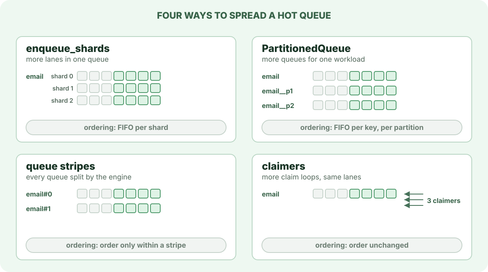

# Scaling a hot queue

One busy queue can outgrow the coordination around a single [lane](lanes-and-claiming.md). A lane admits one producer at a time, because a producer holds it until it commits, and one claimer at a time, because a claim locks the lane's cursor. When many producers and workers share one `(queue, priority)`, they queue behind those two locks while the database still has room.

[Batching](batching.md) is the first answer: a larger claim or insert batch moves more jobs through each lock. When that is not enough, AWA can spread the queue so the work no longer funnels through one lane. Each way of spreading it gives up some ordering.

## The four levers

| Lever | What it splits | Ordering afterwards | Where it is set |
| --- | --- | --- | --- |
| `enqueue_shards` | one queue into several lanes per priority | FIFO within each shard; per key with an ordering key | per queue, in `awa.queue_meta` |
| `PartitionedQueue` | one workload into several ordinary queues, each with its own capacity, rate limit and metrics | FIFO per key within a partition | in producer and worker code |
| `queue_stripe_count` | every logical queue into physical stripes `queue#0`, `queue#1`, … | order only within a stripe; jobs sharing an `ordering_key` share a stripe | storage configuration, for the whole fleet |
| `claimers` | nothing: adds claim loops over the same lanes in one runtime | unchanged | per queue, in `QueueConfig` |

**Enqueue shards** keep one queue name for operators and spread it over up to 64 lanes per priority. A producer picks a shard by hashing the job's ordering key, so jobs with the same key stay in order; without a key, each producer moves to the next shard for each batch. Lowering the shard count is safe at any time. See [Sharding the enqueue head](../configuration.md#sharding-the-enqueue-head-per-queue).

**`PartitionedQueue`** spreads one logical workload over physical queues named `email`, `email__p1`, `email__p2` and so on. Each partition is a complete queue, so worker capacity and rate limits apply per partition: four partitions of 32 workers allow 128. It also routes by key, keeping jobs with the same key in one partition and in order. See [Partitioned queues](../configuration.md#partitioned-queues).

**Queue stripes** are a storage-engine setting that splits every queue the same way, for fleets of many small replicas contending on one queue. Producers that write to queue storage directly should use the same stripe count as the workers. Workers also claim from the unstriped `queue`, which SQL compatibility inserts and unstriped producers write, but jobs there do not share the stripes' load spreading, and an `ordering_key` keeps its order only across producers with the same stripe count.

**Claimers** add claim loops inside one runtime. They share the queue's worker permits and rate limit, so they help only when a single loop cannot keep the workers busy. They add transactions without adding lanes, and in measured hot-queue shapes more claimers made tail latency worse.

## Which to try first

1. Check the claim batch is not the limit: workers sitting idle while the queue has a backlog points at claiming, not at the lane.
2. If the workload has a natural key (customer, account, order) and can live with per-key ordering, use `PartitionedQueue`: it also gives each partition its own worker capacity and rate limit.
3. If the queue must stay one queue to operators, raise `enqueue_shards`. In a 16-producer benchmark, 2, 4 and 8 shards gave 1.6, 2.75 and 3.7 times the throughput of one.
4. Use queue stripes only for many small replicas on one queue, and benchmark 2 before going higher.
5. Add claimers last, and only with evidence that one claim loop leaves workers idle.

## Measuring the result

Judge a change by durable completions per second, end-to-end p99 latency, queue depth, and WAL bytes and transactions per completed job. Before spreading a queue, check whether it is short of workers instead: a queue whose [utilization](../configuration.md#sizing-workers-from-utilization) stays above about 0.8 needs more workers or a split by service time. Raising `max_workers` adds workers, and so does a `PartitionedQueue`, whose partitions each get their own; enqueue shards, stripes and claimers add none. The `awa.job.claimed` counter carries an `awa.enqueue.shard` attribute, so a dashboard can confirm that claims are spread evenly across shards.

## Related

- [Queues, lanes and splitting work](queues-lanes-and-splitting-work.md): what each tool changes about a queue, and which combine.
- [Lanes and claiming](lanes-and-claiming.md): what a lane is and how a claim takes from it.
- [Batching](batching.md): moving more jobs through each statement.
- [Choosing a throughput lever](../configuration.md#choosing-a-throughput-lever) and [ADR-025](../adr/025-sharded-enqueue-heads.md): settings and design records.
