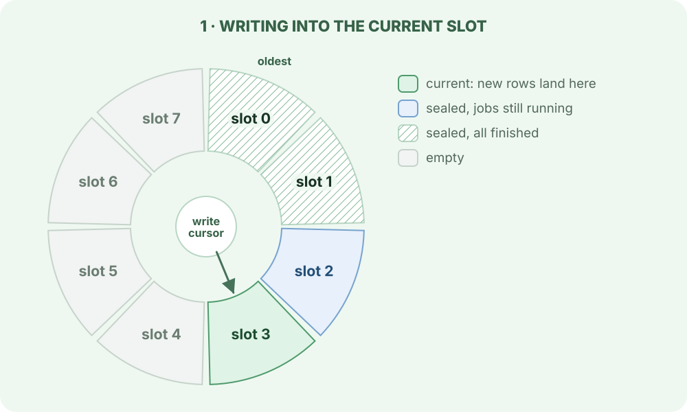
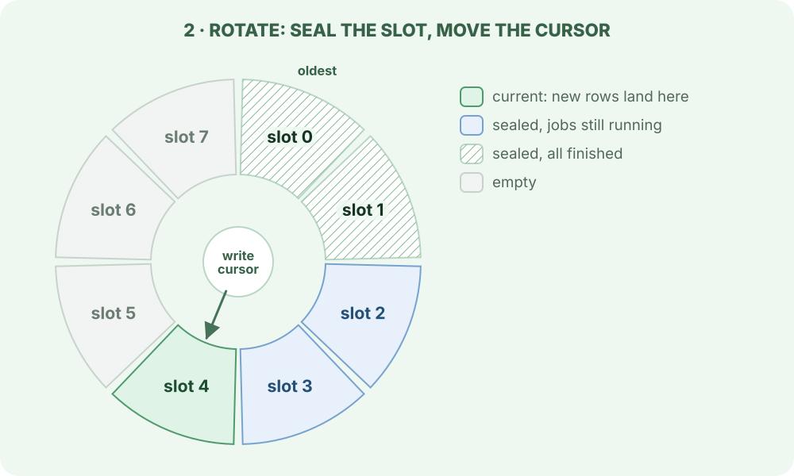
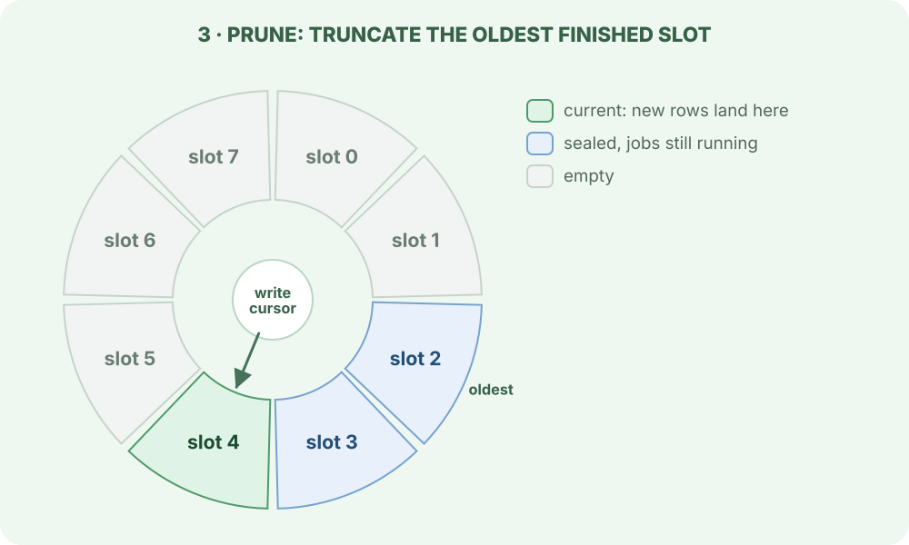
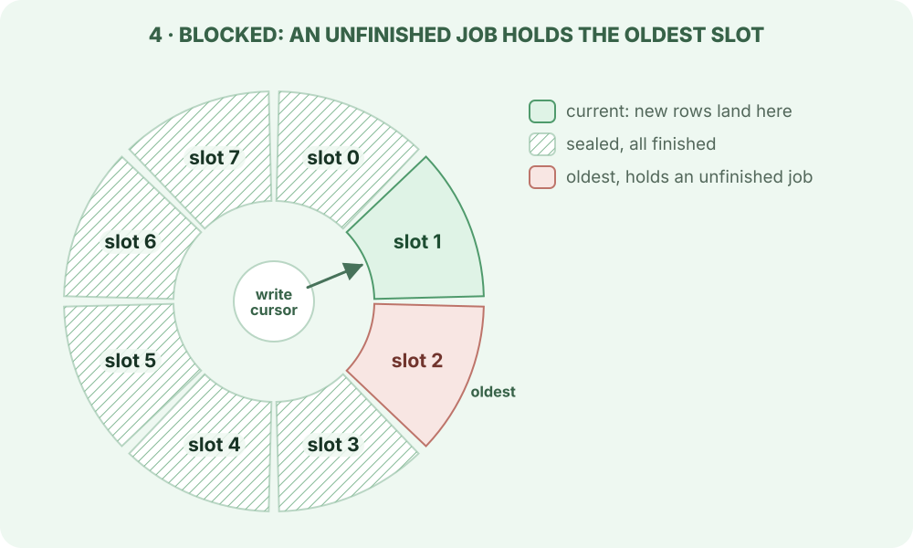

> For the complete AWA documentation index, see [`llms.txt`](../../llms.txt).

# Rings: rotation and prune

A busy job queue writes and discards rows all day. In an ordinary table every deleted or updated row leaves a dead row behind for vacuum to clean up, and one long-running transaction anywhere in the database stops vacuum from cleaning any of them. AWA avoids that on its hot path: it writes to partitions arranged in a ring and reclaims a whole partition at once with `TRUNCATE`, which leaves nothing for vacuum to do.

## One ring, four steps

Each ring is a fixed number of slots, each slot a set of partitions. The maintenance leader advances the ring in two kinds of step: **rotate** seals the current slot and starts writing to the next one, and **prune** truncates the oldest sealed slot once nothing in it is still in use.

=== "1. Write"

    

    
    

    New rows go to the current slot. Older slots are sealed: nothing new is written to them, but jobs that started there can still finish there.

=== "2. Rotate"

    

    
    

    When the current slot is old enough or large enough, the leader moves the write cursor to the next slot. It only rotates into an empty slot.

=== "3. Prune"

    

    
    

    The leader checks that the oldest sealed slot holds no unfinished work, takes exclusive locks on its partitions with a short timeout, checks again, and truncates them. If the locks are not granted in time it gives up and tries on a later tick.

=== "4. Blocked"

    

    
    

    Prune only ever takes the oldest sealed slot. While a job in that slot is unfinished, prune waits, and so does every finished slot behind it. Once the ring has wrapped round to that slot, rotation stops as well and the current slot keeps growing. Both resume as soon as the job finishes or is rescued.

## The three rings

| Ring | Each slot holds | Default slots | A sealed slot can be truncated when |
| --- | --- | --: | --- |
| Queue | ready jobs, their terminal history and the bookkeeping for both | 16 | every ready job in it has been claimed or cancelled, and every attempt claimed from it has ended |
| Claim | claim receipts and their closures | 8 | every receipt in it has a closure |
| Lease | leases of attempts waiting on a callback | 8 | it is empty |

A job's rows are spread across the rings: its ready row and terminal history in one queue slot, its receipts in the claim slots that were current when it was claimed. So one attempt that is still running keeps both its queue slot and its claim slot from being pruned.

## When rotation happens

The leader runs each ring's maintenance about once a second. A non-empty slot becomes eligible to rotate when either:

- it has been filling for at least 5 seconds and holds at least 256 rows, or
- its storage has reached 2 MiB, or
- it has been current for 60 seconds.

A busy queue therefore rotates every few seconds and a quiet one about once a minute. A ring with no rows anywhere stops rotating, which is expected on an idle queue. These thresholds are set with `ring_rotation_cadence`; see [Architecture: partition rotation and reclamation](../../architecture/index.md#partition-rotation-and-reclamation).

## What holds a ring back

| Cause | What you see | What to do |
| --- | --- | --- |
| A job that runs for a long time | its slots stay sealed until it finishes; the rings move again afterwards | expected; give long jobs a realistic `deadline_duration` so a hung one is rescued |
| A worker killed with jobs in flight | the claim ring reports `skipped_busy` until rescue closes the dead worker's attempts | see [claim ring stops rotating](../../troubleshooting/index.md#claim-ring-stops-rotating-after-a-runtime-is-killed) |
| A long transaction on the primary | prune is blocked or skipped while the transaction holds old row versions or locks | keep analytical reads off the primary; see [MVCC discipline](../../deploying-on-managed-postgres/index.md#mvcc-discipline-long-running-readers-pin-the-whole-database) |
| Readers holding locks on a sealed partition | prune reports `blocked` and retries | usually transient; persistent blocking points at a long-lived reader |

A ring that stops moving does not lose work or stop dispatching: jobs are still claimed and finished, and the current slot simply grows until the ring can move again. Watch `awa.ring.generation` per ring and `awa.maintenance.rotate.attempts` and `awa.maintenance.prune.attempts` by outcome; a generation that stays flat while rows accumulate is the condition to alert on.

## What is not in a ring

- **Deferred jobs** (scheduled, snoozed and retrying) live in one ordinary table. Promotion deletes each row as it moves the job into a lane.
- **The dead-letter queue** is an ordinary table with its own retention.
- **Attempt state** holds one small row per attempt that has heartbeated, deleted when the attempt finishes.
- **Control tables** such as lane cursors and runtime snapshots are small and written in place.

## Related

- [Claims, receipts and leases](../claims-receipts-and-leases/index.md): which rows an attempt writes into each ring.
- [Architecture: partition rotation and reclamation](../../architecture/index.md#partition-rotation-and-reclamation): the exact checks and lock order for every ring.
- [ADR-019](../../adr/019-queue-storage-redesign/index.md), [ADR-023](../../adr/023-receipt-plane-ring-partitioning/index.md) and [ADR-040](../../adr/040-append-only-ring-rotation-ledger/index.md): the design records.
