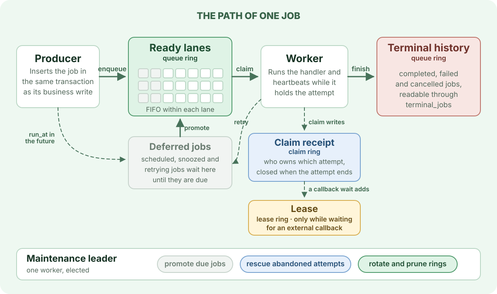

> For the complete AWA documentation index, see [`llms.txt`](../llms.txt).

# How AWA works

AWA is a library and a PostgreSQL schema, not a separate broker. Producers, workers and operator tools all coordinate through the database, so a job is as durable as the transaction that wrote it.

## The path of one job

1. **Enqueue.** A producer inserts the job, usually in the same transaction as the business write that caused it. A job that is due now is appended to a ready [lane](lanes-and-claiming/index.md); one that is due later waits in deferred jobs.
2. **Claim.** A worker takes the next job from the head of a lane and records a [claim receipt](claims-receipts-and-leases/index.md). The claim increments the job's `run_lease`, the number that identifies this attempt.
3. **Run.** The handler runs while the worker heartbeats the attempt. If the handler registers an external callback, the attempt also gets a lease row that holds the callback state.
4. **Finish.** Completion, failure, cancellation, retry or snooze is written only if the attempt's `run_lease` is still current. A retry or snooze goes back to deferred jobs.
5. **Reclaim.** The rows a job left behind sit in ring partitions. Once every job in an old slot has been claimed or cancelled and every attempt claimed from it has ended, the maintenance leader [truncates the whole slot](rings/index.md) instead of deleting rows one at a time.

If a worker stops heartbeating, the maintenance leader rescues its attempts. Each job runs again if it has attempts left, and otherwise fails or moves to the dead-letter queue. That makes delivery **at least once**: `run_lease` stops a stale worker from overwriting a newer attempt, but it cannot undo a side effect the stale worker already caused. Handlers that call external systems need an idempotency key; see the [failure lab](failure-lab/index.md).

## Three rings

Hot storage is split into three rings of partitions, each rotated and pruned independently:

| Ring | Holds | Default slots |
| --- | --- | --: |
| Queue | ready jobs and the terminal history of jobs claimed from them | 16 |
| Claim | claim receipts and the evidence that each attempt ended | 8 |
| Lease | leases for attempts that register an external callback, or for every claim when `lease_claim_receipts` is off | 8 |

Deferred jobs, the dead-letter queue and the small control tables (lane cursors, ring cursors, runtime snapshots) are ordinary tables outside the rings.

## One maintenance leader

Every worker process dispatches and heartbeats its own attempts. One of them also holds a PostgreSQL advisory lock that makes it the maintenance leader. The leader promotes deferred jobs that are due, rescues abandoned attempts, rotates and prunes the rings, runs cron schedules and publishes queue health. If its connection drops, PostgreSQL releases the lock and another worker takes over from the state in the database.

## Read next

| Page | What it explains |
| --- | --- |
| [Queues, lanes and splitting work](queues-lanes-and-splitting-work/index.md) | What a queue is, and when to use separate queues, priority, shards, partitions or claimers, and which combine |
| [Lanes and claiming](lanes-and-claiming/index.md) | How jobs are ordered, how a producer's commit makes them visible, and how workers pick the next one |
| [Claims, receipts and leases](claims-receipts-and-leases/index.md) | What a claim writes, how heartbeats and rescue work, and how `run_lease` fences out stale workers |
| [Rings: rotation and prune](rings/index.md) | How storage is reclaimed without vacuuming hot tables, and what stops a ring from moving |
| [Batching](batching/index.md) | Where AWA handles jobs in groups to cut round trips and commits, and the settings for each |
| [Scaling a hot queue](scaling-a-hot-queue/index.md) | Shards, partitions, stripes and claimers: what each splits and what ordering it gives up |
| [Job lifecycle](job-lifecycle/index.md) | Every state a job can be in and how handlers move it between them |
| [Transactional enqueue](transactional-enqueue/index.md) | Committing a job with the business write that caused it |
| [Architecture](../architecture/index.md) | The reference description of every table, invariant and maintenance path |

## Crates

- `awa-model` owns the schema, migrations, typed records, enqueue operations and admin queries.
- `awa-worker` owns claiming, execution, heartbeats, retries, maintenance and graceful shutdown.
- `awa` is the Rust facade that joins them; `awa-pg` exposes the same model and worker runtime to Python.
- `awa-cli` and the web UI provide migrations and operator tools.
